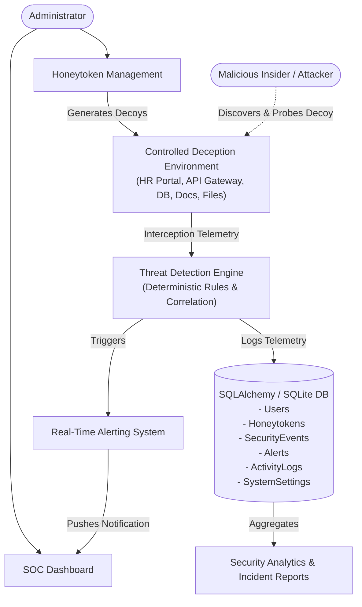
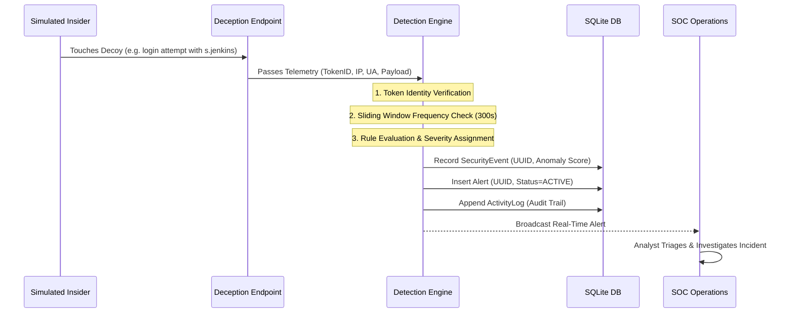
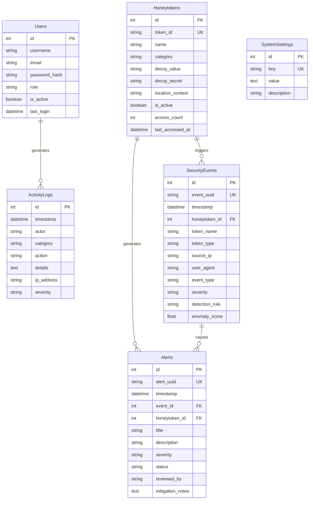

# HONEYGUARD - System Architecture & Deception Design Specification

## 1. Architectural Overview

HONEYGUARD is an enterprise-grade deception and insider threat detection architecture designed to identify unauthorized internal access, credential stuffing, data exfiltration, and lateral movement with **zero false positives**.

Unlike traditional perimeter defenses (firewalls, IDS/IPS, SIEMs) that inspect massive amounts of noisy network traffic and rely on probabilistic heuristics, honeytokens operate on a **deterministic deception paradigm**:

> **The Fundamental Axiom of Honeytokens:**
> Honeytokens are fake digital assets with *zero operational utility* in the organization. Because no legitimate employee, script, or business process has a valid reason to interact with these assets, **any interaction is by definition unauthorized and suspicious**.

---

## 2. Deception Technology Asset Classes

HONEYGUARD manages 5 distinct categories of digital honeytokens placed strategically across enterprise attack surfaces:

| Category Code | Description | Placement Context | Associated Risk Mitigated |
| :--- | :--- | :--- | :--- |
| **`EMPLOYEE_CREDENTIAL`** | High-privilege fake employee identities & passwords | Active Directory, HR Directory, Internal Wiki | Insider impersonation, credential harvesting, unauthorized login |
| **`API_KEY`** | High-entropy cloud & service canary tokens (`AKIA...`, `ghp_...`) | GitHub repos, Slack channels, `.env.example` files | Code leakage, CI/CD compromise, secret exfiltration |
| **`DATABASE_CREDENTIAL`** | Decoy database connection strings (`postgres://...`) | Internal BI configs, migration scripts, dev shares | Internal database enumeration, SQL reconnaissance |
| **`DECOY_DOCUMENT`** | Canary-tagged restricted corporate files (`M&A_Report.pdf`) | Shared network drives (`//corp-fs01/`), SharePoint | Corporate espionage, data theft, IP exfiltration |
| **`SENSITIVE_FILE`** | Decoy configuration files (`.env.production.bak`, `aws/credentials.old`) | Web root directories, developer home directories | Directory traversal, privilege escalation, secret hunting |

---

## 3. Threat Detection Engine Internal Mechanics

The HONEYGUARD Detection Engine (`backend/app/detection/engine.py`) operates via a multi-stage deterministic pipeline:

### Deterministic Rule Matrix

HONEYGUARD uses explicit, explainable rules rather than opaque black-box machine learning models:

1. **`RULE-101-CREDENTIAL-DECOY`** (Severity: `HIGH`, Score: 88.0)
   - *Condition:* An authentication request contains credentials matching an active decoy employee.
   - *Rationale:* Decoy credentials have no legitimate operational use. Signals intentional credential stuffing or identity theft.

2. **`RULE-102-API-KEY-EXFILTRATION`** (Severity: `HIGH`, Score: 90.0)
   - *Condition:* An HTTP header or parameter contains a deployed canary API key.
   - *Rationale:* The key was deliberately planted in internal documentation or repositories to catch exfiltration.

3. **`RULE-103-DATABASE-CREDENTIAL-TAMPERING`** (Severity: `HIGH`, Score: 92.0)
   - *Condition:* Decoy database connection string or user submitted in database query routes.
   - *Rationale:* Indicates an insider is probing internal database segments for unauthorized access.

4. **`RULE-104-CONFIDENTIAL-DOC-LEAK`** (Severity: `HIGH`, Score: 86.0)
   - *Condition:* A canary-tagged decoy file is opened or downloaded from an internal repository.
   - *Rationale:* Signals exfiltration of restricted files (M&A memos, payroll spreadsheets).

5. **`RULE-105-SENSITIVE-FILE-INSPECTION`** (Severity: `HIGH`, Score: 84.0)
   - *Condition:* Directory traversal or file inspection targeted at dummy configuration files.
   - *Rationale:* Confirms attacker is scanning local filesystems for plaintext secrets.

6. **`RULE-201-BURST-CORRELATION`** (Severity: `CRITICAL`, Score: 98.5)
   - *Condition:* $\ge 3$ distinct decoy touches from the same Source IP within a 300-second sliding window, or multi-vector attack simulation triggered.
   - *Rationale:* Multi-vector correlated reconnaissance confirms an active, automated attack or deliberate insider harvesting campaign.

7. **`RULE-202-INACTIVE-TOKEN-PROBE`** (Severity: `MEDIUM`, Score: 55.0)
   - *Condition:* Interaction intercepted on a revoked or disarmed honeytoken.
   - *Rationale:* Actor possesses stale exfiltrated data or is executing historical fuzzing.

---

## 4. Database Schema & Data Flow

HONEYGUARD relies on 6 relational models managed via SQLAlchemy ORM:

